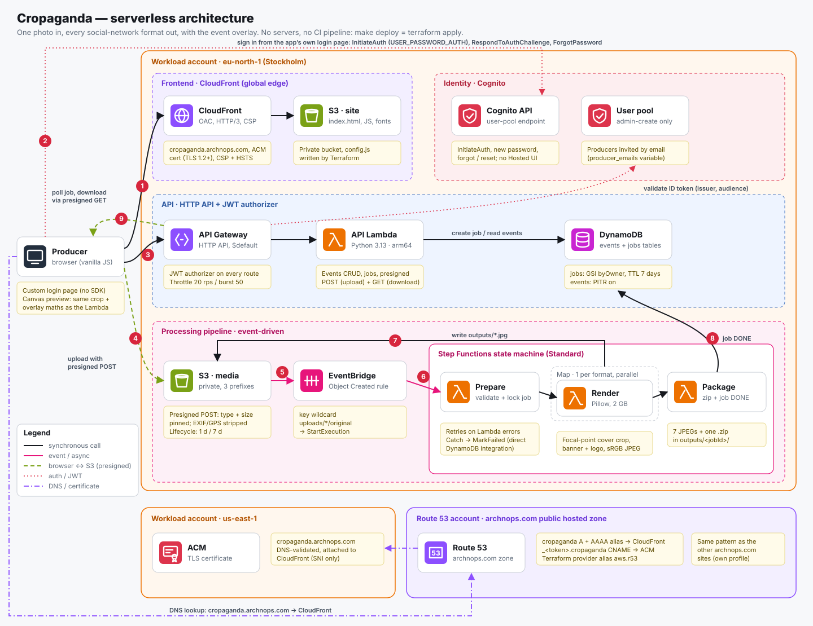

# Cropaganda

**One photo. Every feed. On message.**

Cropaganda is a small web app for content producers working at conferences. Upload a photo from the venue floor, click the subject, and get it back cropped for every social network, each version with the event banner (name, date, location, hashtag, logo) applied. Download them one by one or as a zip.

Built for the *No Pipeline, No Problem* weekend challenge: everything is a managed, scale-to-zero AWS service, and deploying is one `terraform apply` from a laptop. No servers, no containers, no CI pipeline.



## How it works

1. **Load the app** at **https://cropaganda.archnops.com**. CloudFront serves the static frontend from a private S3 bucket (OAC), with a strict Content-Security-Policy, on an ACM certificate (us-east-1). The DNS records live in the `archnops.com` zone, in a separate Route 53 account.
2. **Sign in.** Cropaganda's own login page (no Cognito Hosted UI, no SDK) calls the Cognito user-pool API with `fetch()`: `InitiateAuth` (`USER_PASSWORD_AUTH`), `RespondToAuthChallenge` for the first sign-in with the invitation password, and `ForgotPassword` / `ConfirmForgotPassword` for resets. The user pool is invite-only.
3. **Create a batch.** The browser calls the HTTP API (Cognito JWT authorizer on every route). The API Lambda stores the job in DynamoDB and returns a **presigned POST** pinned to the job's key, the file's content type and the size limit.
4. **Upload.** The browser posts the photo straight to S3 (`uploads/<jobId>/original`). It never goes through Lambda or API Gateway.
5. **S3 → EventBridge.** The bucket sends *Object Created* events to EventBridge; a rule matching `uploads/*/original` starts the state machine. No glue Lambda.
6. **Step Functions** runs `Prepare` (validates the image, locks the job `AWAITING_UPLOAD → PROCESSING`), then a **Map** state renders every selected format in parallel, then `Package`.
7. **Render** (Pillow, 2 GB, arm64): EXIF-aware decode, conversion to sRGB, focal-point cover crop, event banner + logo (or the event's own banner strip or full frame), metadata (incl. GPS) stripped, JPEG written to `outputs/<jobId>/`.
8. **Package** zips everything and marks the job `DONE`. Any failure is caught and written to the job by a **direct DynamoDB integration** (`MarkFailed`), again without a Lambda.
9. **Download.** The browser polls the job; once it is done the API returns presigned GET URLs for each file and the zip.

Originals expire after 1 day and rendered files after 7 days (S3 lifecycle + DynamoDB TTL). Producers can also delete a batch themselves.

### Formats

Defined once in [`backend/shared/formats.json`](backend/shared/formats.json) and used by both the API and the renderer:

| Format | Size | Notes |
|---|---|---|
| Instagram post (square) | 1080×1080 | |
| Instagram post (portrait 4:5) | 1080×1350 | |
| Story / Reels / TikTok (9:16) | 1080×1920 | banner kept out of the top 13 % / bottom 18 % where the apps draw their UI |
| LinkedIn post | 1200×627 | |
| X post (16:9) | 1600×900 | |
| Facebook post | 1200×630 | |
| Bluesky / Mastodon (16:9) | 1200×675 | |

Add or change a format by editing that file and redeploying.

### Bring your own banner

An event can use its own banner image instead of the generated one (event dialog → **Banner → Upload my own**). It is a wide strip, about 8:1 and at least 2000 px wide (PNG with transparency, JPEG or WebP, up to 5 MB). Every format gets it at full width, aspect ratio kept, against the top or bottom edge but outside the platform's UI zones; a taller image is scaled down to 35 % of the height and centred. The file is stored next to the event logo (`logos/<eventId>/banner-*`), so the existing IAM policies and cleanup cover it. If the file can't be read at render time, the pipeline falls back to the generated banner.

### Full-frame overlays

For a designed frame around the whole photo (logo bar, skyline, border…), pick **Banner → My full frame** and upload PNGs with a transparent window. There are four slots, one per shape: square 1:1, portrait 4:5, story 9:16 and landscape 16:9 (also used for the 1.91:1 LinkedIn / Facebook sizes, close enough not to show). Each frame is scaled to cover its output exactly. A shape without its own frame borrows the uploaded frame with the nearest ratio, stretched to fit, and the dialog says so next to that slot. Upload one frame per shape when that stretch shows. Frames live under `logos/<eventId>/frame-<shape>-*` (8 MB max each) and replace both banner styles; the slot each format uses is the `frame` field in [`backend/shared/formats.json`](backend/shared/formats.json).

### The preview is honest

The frontend draws a live preview of every format on a `<canvas>` using the same crop maths and banner layout as the render Lambda ([`frontend/js/preview.js`](frontend/js/preview.js) mirrors [`backend/functions/pipeline/imaging.py`](backend/functions/pipeline/imaging.py)), with the same Inter font. The producer sees the result before uploading, while the full-resolution files are still rendered on AWS.

## Services used

| Service | Role |
|---|---|
| Amazon S3 | frontend hosting (private), media storage, direct browser upload/download |
| Amazon CloudFront | HTTPS on `cropaganda.archnops.com`, HTTP/3, security headers |
| AWS Certificate Manager | TLS certificate for the custom domain (us-east-1, DNS-validated) |
| Amazon Route 53 | `archnops.com` hosted zone (separate account): certificate validation + A/AAAA alias records |
| Amazon Cognito | invite-only producer accounts, used by the app's own login page |
| Amazon API Gateway (HTTP API) | REST endpoints, JWT authorizer, throttling |
| AWS Lambda | API (Python 3.13) and pipeline tasks (Python 3.13 + Pillow), all arm64 |
| AWS Step Functions | orchestration: Map fan-out, retries, catch → direct DynamoDB update |
| Amazon EventBridge | S3 upload event → start execution |
| Amazon DynamoDB | events and jobs (GSI by owner, TTL) |

## Deploy

Requirements: Terraform ≥ 1.17, [uv](https://docs.astral.sh/uv/) (it fetches Python 3.13 and the Lambda build of Pillow), and credentials for two AWS accounts: the **workload** account (everything) and the account that owns the **`archnops.com` hosted zone** (DNS records only). Terraform uses one named profile per account, as in the other archnops.com sites.

```bash
cat > infra/terraform.auto.tfvars <<'EOF'
profile_r53     = "<route53-account-profile>"    # account that owns archnops.com
# profile       = "<workload-account-profile>"  # or AWS_PROFILE / SSO env
producer_emails = ["you@example.com"]           # Cognito emails each one a temporary password
EOF

make deploy      # = scripts/build.sh + terraform init -backend-config=backend.hcl + terraform apply
```

Terraform prints `site_url` (https://cropaganda.archnops.com/) at the end. The first apply waits a minute or two for the certificate to validate. Open the site, sign in with the emailed temporary password, set a new one, create an event, drop a photo.

Default region is `eu-north-1` (Stockholm); change it with `region = "..."` in `terraform.auto.tfvars`. Other variables are in [`infra/variables.tf`](infra/variables.tf) (`environment`, `domain_name`, `hosted_zone_name`, `retention_days`, `max_upload_mb`, `allow_localhost`, `log_retention_days`). [`infra/terraform.tfvars.example`](infra/terraform.tfvars.example) lists them.

State is kept in S3 in the shared-services account (`cropaganda/terraform.tfstate`, native S3 locking). The settings are in `infra/backend.hcl`, which is git-ignored; create it from this if you clone the repo:

```hcl
profile      = "<shared-services-profile>"
bucket       = "<state-bucket>"
key          = "cropaganda/terraform.tfstate"
region       = "eu-north-1"
encrypt      = true
use_lockfile = true
```

### Naming

Every resource name is built in [`infra/locals.tf`](infra/locals.tf) as `<env>-<service>-<region>-<app>-<descriptor>`: the first letter of `environment` (`p` for `prd`), a service code (`s3`, `ddb`, `cog`, `agtw`, `lbd`, `iam`, `sfn`, `evb`, `cf`), the region code (`eun1` for eu-north-1, `glb` for global services such as IAM and CloudFront), the app slug and what the resource is. For example `p-lbd-eun1-cropaganda-render` or `p-ddb-eun1-cropaganda-table-jobs`. Log groups follow the path each service expects (`/aws/lambda/<function>`, `/aws/apigateway/<api>`, `/aws/vendedlogs/states/<state machine>`).

Invite more people later:

```bash
aws cognito-idp admin-create-user \
  --user-pool-id "$(terraform -chdir=infra output -raw user_pool_id)" \
  --username someone@example.com \
  --user-attributes Name=email,Value=someone@example.com Name=email_verified,Value=true
```

or add them to `producer_emails` and `make deploy` again.

## Work on it

Python tooling is [uv](https://docs.astral.sh/uv/): dependencies are in `pyproject.toml` (dependency groups `pipeline` and `dev`) and pinned in `uv.lock`. `uv sync` sets up `.venv`; the Lambda's Pillow version comes from the same lock file.

```bash
make test        # uv run pytest: API + pipeline handlers end to end against moto, no AWS account needed
make dev         # frontend on http://localhost:5173 against the deployed backend
```

`make dev` writes `frontend/config.js` from the Terraform outputs (that file is git-ignored and never uploaded by Terraform; the deployed one is generated). `allow_localhost = false` removes localhost from the CORS origins once you no longer need it.

## Security notes

- Invite-only user pool, no self sign-up; tokens are kept in `sessionStorage`, refreshed with the refresh token and revoked (`RevokeToken`) on sign-out.
- The login page uses `USER_PASSWORD_AUTH`: the password goes to Cognito over TLS (never to our API). The alternative is `USER_SRP_AUTH`, where the password never leaves the browser; it needs an SRP implementation (or the Amplify library) in the frontend.
- Password rules are checked live in the page and match the user pool policy (12+ characters, upper, lower, number). Cognito error messages are mapped to neutral texts, and user-existence errors are suppressed.
- Every API route requires a valid Cognito ID token; jobs are scoped to their owner (`sub`); every producer can use any event, but only its creator can change or delete it.
- Uploads use presigned POST policies that pin the exact key, content type and maximum size; URLs expire after 5 minutes. A re-posted form cannot start a second run (the job lock in `Prepare`).
- Pillow decompression-bomb guard (120 MP), image re-encoded, all metadata dropped, including EXIF GPS.
- Buckets are private, TLS-only, SSE-S3; CloudFront sends CSP, HSTS, `X-Frame-Options: DENY`, `nosniff`.
- Least-privilege IAM per function, Step Functions and EventBridge role.

## Layout

```
backend/
  shared/formats.json            output formats (single source of truth)
  functions/api/app.py           HTTP API handler
  functions/pipeline/            prepare / render / package handlers, imaging.py, Inter fonts
frontend/                        static app: index.html, styles.css, js/, fonts/
infra/                           Terraform: one file per service, names in locals.tf (+ pipeline.asl.json state machine)
scripts/build.sh                 builds the Lambda packages (uv installs Pillow for linux/arm64)
pyproject.toml, uv.lock          Python deps: "pipeline" group (Lambda) and "dev" group (tests)
tests/                           moto end-to-end tests
docs/architecture.svg
```

## Clean up

```bash
make destroy
```

Buckets are created with `force_destroy`, so this removes the photos too.

## Ideas for later

- WAF rate limiting on CloudFront (e.g. the shared CloudFront web ACL used by the other archnops.com sites); `api.cropaganda.archnops.com` for the HTTP API, or the API behind CloudFront on `/api`.
- Overlay templates per format (e.g. a corner badge for Stories), multiple photos per batch.
- Share a batch with a teammate, or push straight to a social scheduler.

Fonts: [Inter](https://github.com/rsms/inter), SIL Open Font License 1.1 (see `backend/functions/pipeline/fonts/OFL.txt`).
