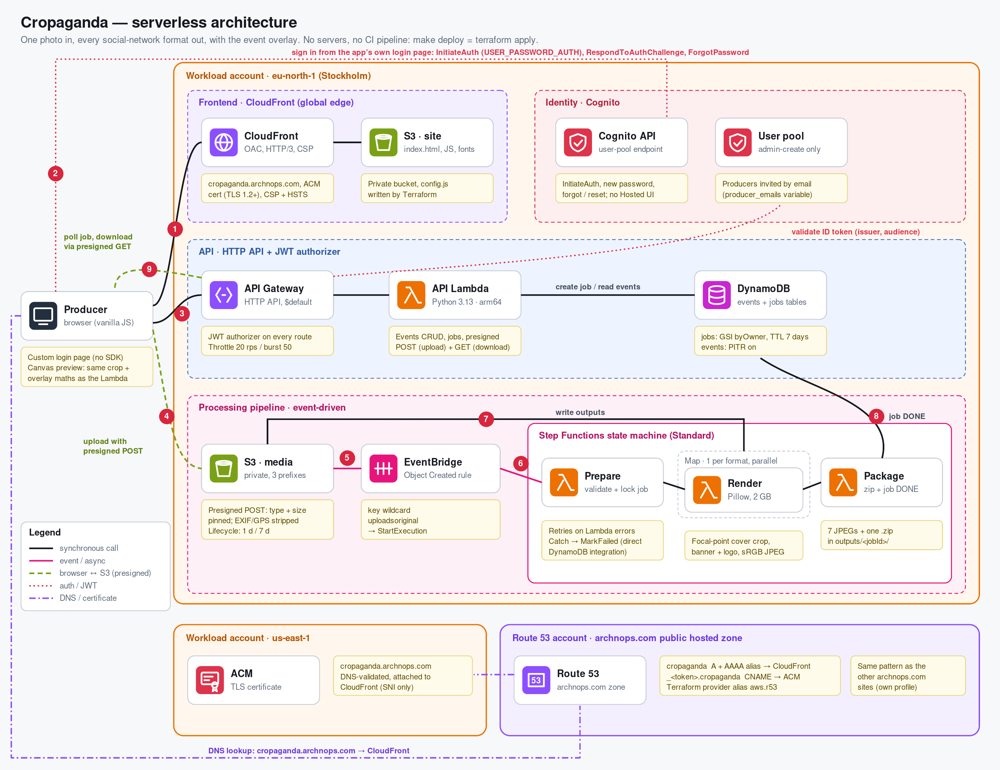

# Cropaganda: one conference photo, every social feed, zero servers

**One photo. Every feed. On message.**

*Built for the AWS Builder Center weekend challenge "No Pipeline, No Problem". Repo: [github.com/jimmy-ao/weekend-challenge_no-pipeline-no-problem](https://github.com/jimmy-ao/weekend-challenge_no-pipeline-no-problem). Live at [cropaganda.archnops.com](https://cropaganda.archnops.com) (invite-only).*

<!-- DEMO VIDEO: paste the link to the < 3 min video here -->

---

## The problem: the keynote ends, and the photo is still on your phone

Anyone who has covered a conference for social media knows this moment. You have the shot: the speaker mid-sentence, the packed room, the booth with the queue. Now it has to go out, and "out" means seven different places that each want something different.

Instagram wants a square, or a 4:5 portrait. Stories, Reels and TikTok want 9:16, and they draw their own buttons over the top and the bottom of your picture. LinkedIn wants 1200×627. X wants 16:9. Facebook, Bluesky and Mastodon each have their own landscape size. And the marketing team wants every single one of them to carry the event branding: name, date, city, hashtag, logo, the right colours.

So you crop by hand, seven times, in an app that cuts the speaker's head off at least once, you paste the logo in the wrong corner, and twenty minutes later the moment has passed. Or you use a template tool that was never designed for "I am standing in a hallway with 4 % battery".

I wanted something much simpler: **drop the photo, click on what matters, get every format back, already branded.**

## What Cropaganda does

Cropaganda is a small web app for content producers working at events.

1. **Set up the event once.** Name, date label, location, hashtag, colours, an optional logo. If the design team already has artwork, upload it instead: either a wide banner strip, or full-frame overlays (one per shape: square, portrait, story, landscape) with a transparent window for the photo.
2. **Drop a photo and click the subject.** That click is the focal point. Every crop keeps it in frame, whatever the aspect ratio.
3. **Check the live preview.** Every format is drawn in the browser before anything is uploaded.

<!-- SCREENSHOT: save a capture of the app (event set up, photo dropped, previews visible) as docs/screenshot-app.png -->

4. **Get the files.** Every format is rendered at full resolution on AWS, with the overlay applied and all metadata stripped. Download them one by one or as a single zip.

Seven formats out of the box:

| Format | Size |
|---|---|
| Instagram post (square) | 1080×1080 |
| Instagram post (portrait 4:5) | 1080×1350 |
| Story / Reels / TikTok (9:16) | 1080×1920 |
| LinkedIn post | 1200×627 |
| X post (16:9) | 1600×900 |
| Facebook post | 1200×630 |
| Bluesky / Mastodon (16:9) | 1200×675 |

For the 9:16 format, the banner stays out of the top 13 % and the bottom 18 % of the frame, where the apps draw their own UI. It is a small detail, but it is the difference between "branded" and "hidden behind the reply box".

## The architecture



Everything is managed and scales to zero. Here is the path of one photo:

1. **CloudFront** serves the static frontend from a private **S3** bucket (Origin Access Control) on `cropaganda.archnops.com`, with an **ACM** certificate and **Route 53** records in a separate DNS account. Strict Content-Security-Policy, HSTS, the usual headers.
2. **Sign-in** goes to **Amazon Cognito**. No Hosted UI and no SDK: the app's own login page calls the user-pool API directly with `fetch()` (`InitiateAuth`, `RespondToAuthChallenge` for the first login, `ForgotPassword` for resets). The pool is invite-only.
3. **Create a batch.** The browser calls an **API Gateway HTTP API** with a Cognito JWT authorizer on every route. A **Lambda** function stores the job in **DynamoDB** and returns a **presigned POST**.
4. **Upload.** The photo goes straight from the browser to S3. It never passes through API Gateway or Lambda.
5. **S3 → EventBridge → Step Functions.** The bucket emits *Object Created* events to **EventBridge**, and a rule matching `uploads/*/original` starts the state machine. No glue Lambda in between.
6. **Step Functions** runs `Prepare` (validate the image, lock the job), then a **Map** state renders every selected format in parallel, then `Package` zips the results.
7. **Download.** The browser polls the job; when it is `DONE`, the API returns presigned GET URLs for each image and for the zip.

Originals expire after one day and rendered files after seven, through S3 lifecycle rules and DynamoDB TTL. Producers can also delete a batch themselves.

## The choices I am happy with

### Let the managed services do the glue

The usual reflex is a small Lambda that receives the S3 notification and calls `StartExecution`. I skipped it: S3 sends events to EventBridge, and an EventBridge rule with a wildcard on the key targets the state machine directly.

Same thing on the failure path. If anything goes wrong, the state machine catches it and writes `FAILED` plus the error cause on the job with a **direct DynamoDB `updateItem` integration**. A condition expression makes sure it only moves a job that is still waiting or processing. That is one less function to write, deploy, monitor and pay for, and the code that remains is only the code that does real work: decoding and drawing images.

```json
"MarkFailed": {
  "Type": "Task",
  "Resource": "arn:aws:states:::dynamodb:updateItem",
  "Parameters": {
    "TableName": "${jobs_table}",
    "Key": { "jobId": { "S.$": "$.jobId" } },
    "UpdateExpression": "SET #s = :failed, #e = :error",
    "ConditionExpression": "#s IN (:waiting, :processing)",
    ...
  }
}
```

The job ID itself is extracted from the S3 key with intrinsic functions in a `Pass` state (`States.ArrayGetItem(States.StringSplit($.key, '/'), 1)`), so the first Lambda already receives clean input.

### Fan-out with a Map state

Each format is an independent render, so it is a textbook Map: one Lambda invocation per format, up to eight in parallel, each with its own retries on transient Lambda errors. The total time is roughly the time of the slowest format, not the sum of all of them. Adding an eighth format costs nothing in latency.

### Uploads that cannot be abused

The presigned POST pins the exact object key, the content type and the maximum size, and it expires after five minutes. If the same form is posted twice, `Prepare` sees that the job is already locked (`AWAITING_UPLOAD → PROCESSING` is a conditional write) and the second execution ends quietly in an `IgnoreDuplicate` state. No double work, no race.

### An honest preview

The preview in the browser is not an approximation. `frontend/js/preview.js` mirrors `backend/functions/pipeline/imaging.py`: same cover-crop maths around the focal point, same banner layout, same safe zones, and the same Inter font files. What the producer sees on the `<canvas>` is what Pillow renders on AWS, just at screen resolution.

The list of formats lives in one file, `backend/shared/formats.json`, read by both the API and the renderer. Adding a network is one JSON entry and a redeploy.

### The image work is careful, because photos are personal

The render Lambda (Python 3.13, Pillow, 2 GB, arm64) does the boring things that matter:

- honours EXIF orientation, so portrait phone photos are not sideways;
- converts embedded colour profiles to sRGB, so the brand colours look the same everywhere;
- refuses decompression bombs above 120 MP, but accepts big DSLR files;
- **strips every piece of metadata, including GPS coordinates**, before writing the JPEG.

Nobody posting from a conference should leak where they slept the night before because the hotel-room test shot still had its location tag.

## No pipeline, really

Deploying Cropaganda is one command from a laptop:

```bash
make deploy   # build the Lambda packages, terraform init, terraform apply
```

Everything is in **Terraform**: buckets, CloudFront, certificate, DNS records in the other account (one AWS provider per account), Cognito, the HTTP API, the Lambdas, the state machine (an ASL JSON file templated with the function ARNs), the EventBridge rule, DynamoDB, and least-privilege IAM roles for each function, for Step Functions and for EventBridge.

Python dependencies are managed with **uv**: `pyproject.toml` has a `pipeline` group for the Lambda and a `dev` group for the tests, both pinned in `uv.lock`. The build script asks uv for the Linux arm64 wheel of Pillow, so the package built on a Mac is the one that runs on Lambda.

Tests run the API and the pipeline handlers end to end against **moto**, with no AWS account needed:

```bash
make test
```

No CI server, no container registry, no build agent to patch. When the weekend is over, `make destroy` removes everything, photos included.

## Scale to zero, for real

Conference traffic is the definition of spiky: nothing for weeks, then hundreds of photos in two days. Every component here follows that curve. Lambda, Step Functions, API Gateway, EventBridge and DynamoDB on-demand are billed per request; CloudFront and S3 per use. Between events, the only thing left is a few kilobytes of event settings and logos, since photos delete themselves after a few days. There is nothing to stop, nothing to resize and nothing to patch.

## What I would add next

- AWS WAF rate limiting in front of CloudFront, and the API behind the same domain.
- Overlay templates per format, for example a corner badge for Stories.
- Several photos per batch, and sharing a batch with a teammate.
- Pushing the results straight to a social media scheduler.

## Wrap-up

Cropaganda solves a small, very real problem for people who work at events, and it does it with ten managed AWS services and no server anywhere. The pieces I wrote are the ones that carry the actual value: the crop maths, the overlay layout, the image hygiene. Everything else (scaling, retries, fan-out, events, auth, storage expiry) is configuration.

That was the promise of the challenge: an idea on Friday, a working thing by Monday, and nothing to babysit afterwards. Cropaganda keeps it.

*Jimmy Morin, Cloud Infrastructure Engineer, [Arch'n'Ops](https://archnops.com), Stockholm.*

#serverless #aws #stepfunctions #lambda #terraform
